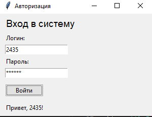

# Приложение с регистрацией

## Участники

Пыжов Дмитрий - создание программы

## Назначение

Программа, в которой есть регистрация

## ТЗ

В программе должно быть 2 поля (логин и пароль). Также при нажатии на кнопку "Войти" должно высвечиваться "Привет, (имя)"

## Запуск
Запустите регистрация.py

## Скриншот

## Результат проверки

Всё соответствует требованиям.
